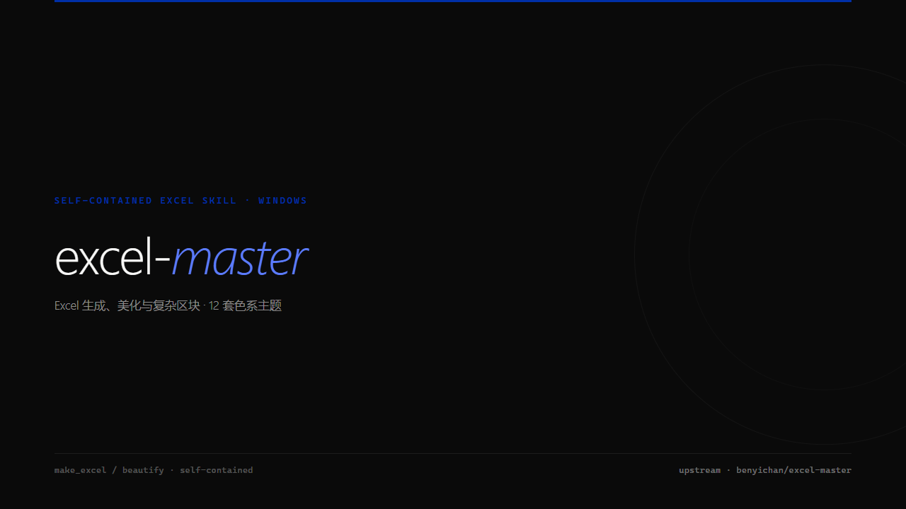

<div align="center">
  
</div>

<br>

# excel-master

自包含的 Excel 生成、美化和复杂区块格式化技能。

核心写表流程使用纯 openpyxl，一次保存，不依赖其他技能或外部项目目录。

## 这是什么

接到「出个 Excel」「美化报表」「导出 xlsx」「格式化复杂表格」等指令时，本目录内的脚本可以独立完成处理。

主要能力：

- **make_excel** — 从 DataFrame 生成摩根系标准格式（B1 起写、A列留空、水蓝表头、千分位、框线上下粗中间细、隐藏网格线）
- **beautify** — 美化已有 xlsx，只改边框/字体/填充/对齐/数字格式/行高/列宽，不碰单元格的值和公式
- **12 套色系主题** — 表头、合计行和数据字体颜色一键切换
- **复杂区块格式化** — 明确指定多级表头或多数据块范围，不靠不可靠的自动猜测

## 色系主题

| 主题名 | 表头 | 合计行 |
|--------|------|--------|
| `default` | 水蓝 `#4472C4` | 浅蓝 `#D9E2F3` |
| `deep-navy` | 深海蓝 `#1F4E79` | 浅蓝 `#D6E4F0` |
| `jade` | 墨玉绿 `#375623` | 浅绿 `#E2EFDA` |
| `slate` | 陨石灰蓝 `#404040` | 浅灰 `#D9D9D9` |
| `burgundy` | 勃艮第红 `#843C0C` | 浅杏 `#FCE4D6` |
| `coral` | 珊瑚橙 `#D84B4B` | 浅粉 `#FDE8E8` |
| `sakura` | 樱花粉 `#D94F70` | 浅粉 `#FDE8EE` |
| `warm-sun` | 暖阳橙 `#E8843A` | 浅橙 `#FEF0E6` |
| `lavender` | 薰衣草紫 `#8B7EC8` | 浅紫 `#EDEAF8` |
| `matcha` | 抹茶绿 `#7BA23F` | 浅绿 `#F0F5E6` |
| `peach` | 蜜桃 `#E8897C` | 浅桃 `#FEF0ED` |
| `misty` | 雾蓝紫 `#6B7FB5` | 浅蓝紫 `#EDF0F8` |

## 作为独立脚本使用

核心功能需要 `pandas` + `openpyxl`：

```bash
pip install pandas "openpyxl>=3.0"
python scripts/make_excel.py 数据.csv 输出.xlsx
python scripts/make_excel.py --beautify 已有报表.xlsx 美化后.xlsx --theme coral
python scripts/make_excel.py --beautify 已有报表.xlsx 美化后.xlsx --freeze-rows 3
python scripts/format_excel_sections.py 复杂表.xlsx 输出.xlsx --section 3:10:2:12
```

Python 调用：

```python
import sys
sys.path.insert(0, r'技能目录\scripts')
from make_excel import make_excel, beautify

# 生成
make_excel(df, '报表.xlsx', theme='deep-navy')

# 美化已有文件（保留公式）
beautify('原始表.xlsx', '美化表.xlsx', theme='slate', freeze_rows=2)

# 条件格式只有明确要求时才跟随主题
beautify('原始表.xlsx', theme='coral', adapt_conditional_formatting=True)
```

原地美化会先把原文件备份到 `C:\Users\<用户名>\BackUp\excel-master_时间戳\` 并校验副本内容；指定另存路径时，若目标已经存在，也先备份目标文件。

## 摩根系九大原则

来自《为什么精英都是Excel控》——行高18、Arial 11、千分位、上下粗框线中间虚线无竖线、数字右对齐文字左对齐、不从A1开始、隐藏网格线、冻结首行。详见 `SKILL.md`。

## 更新日志

### 2026-07-26
- 合并本地版与作者分支的有效能力，主题从6套扩展到12套
- 修复小数金额误判、A列隐藏或空表头误填色、公式对象列宽和取消冻结问题
- 条件格式主题适配改为显式选择，默认保留原有业务含义
- 增加复杂区块格式化和可运行回归测试
- 按用户实际需求移除真实 Excel 截图、敏感列打码及其可选依赖
- 移除其他技能、Hermes目录和外部项目路径依赖，形成自包含版本

### 2026-06-12
- 修复 beautify 冻结窗格位置错误：freeze_panes 从硬编码 A2 改为跟随表头实际位置
- 修复当时的图片敏感列处理脚本；该功能已于 2026-07-26 删除
- 修复 A 列格式覆盖不全：beautify 和 make_excel 的 A 列数据现在会做类型推断，应用正确的数字格式/对齐/颜色
- 扩充业务关键词：pct 和 money 类增加返点/佣金/折扣/补贴/commission/discount/rebate 等常用词
- 扩充合计行关键词：增加 subtotal、汇总
- 代码可维护性：修复步骤编号冲突、消除 THEMES.get() 死代码、_detect_data_range 变量重命名消除歧义
- 文档同步：更新 SKILL.md 过时描述，新增公式保护说明和跨平台限制说明
- 补充 README 更新日志

### 2026-06-10
- 初始发布，支持 make_excel（DataFrame → 摩根系 Excel）、beautify（美化不改数据）、6 套色系主题一键切换
- 架构决策：彻底废弃 xlwings，改用纯 openpyxl 字符估算法，一次保存保证格式完整
- 修复 `end_col` 未定义变量导致 NameError（_apply_styles 和 _beautify_worksheet 两处）
- 修复类型推断优先级（pct > date > text > money），解决"毛利率"误匹配为 money 的问题
- 全表字体统一：所有单元格强制 Font(name='Arial', size=11)
- 确立 beautify 只改格式不改数据原则

## License

MIT
